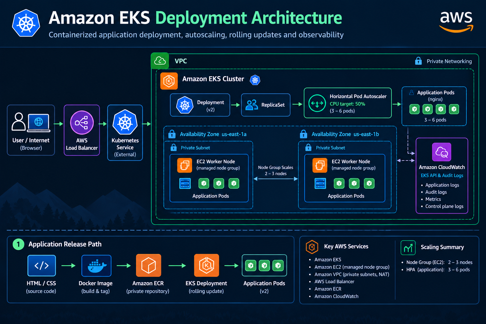

# ☁️ Amazon EKS Deployment

A hands-on Amazon EKS project focused on deploying, exposing, scaling, monitoring, updating, troubleshooting, and cleaning up a containerized application running on Kubernetes in AWS.

This project builds on my previous local Kubernetes labs by moving the workload into a managed AWS environment and exploring how Kubernetes concepts connect to real cloud infrastructure.

---

## 🏗️ Architecture



The application runs on Amazon EKS using a managed EC2 node group distributed across two Availability Zones. Traffic enters through AWS load-balancing infrastructure and a Kubernetes `LoadBalancer` Service before reaching the application pods.

Container images are stored in Amazon ECR, the Horizontal Pod Autoscaler manages pod scaling based on CPU utilization, and EKS API and audit logs are sent to Amazon CloudWatch.

---

## 🎯 Project Goals

The goal of this project was not simply to get an application running on EKS.

I wanted to understand the full path:

**Source Code → Docker Image → Amazon ECR → EKS Deployment → ReplicaSet → Pods → Kubernetes Service → AWS Load Balancer → User**

I also wanted to practice what happens after deployment:

- How Kubernetes responds when a pod fails
- How workloads scale across worker nodes
- How CPU-based Horizontal Pod Autoscaling behaves
- How a new application version rolls out
- How EKS integrates with CloudWatch
- How AWS resources map back to Kubernetes objects
- How to verify cloud resources are actually removed during cleanup

---

## 🛠️ Technologies Used

### AWS

- Amazon EKS
- Amazon EC2
- Amazon ECR
- Amazon VPC
- AWS Load Balancing
- Amazon CloudWatch
- AWS IAM
- AWS CLI

### Kubernetes

- Deployments
- ReplicaSets
- Pods
- Services
- Horizontal Pod Autoscaler
- Metrics Server
- Resource requests and limits
- Rolling updates

### DevOps / Tooling

- Docker
- kubectl
- eksctl
- Git
- GitHub
- Linux / WSL
- Visual Studio Code

---

## ☸️ Building the EKS Cluster

I defined the EKS environment using an `eksctl` configuration file rather than manually building the cluster through the AWS console.

The cluster used:

- Kubernetes 1.36
- Region `us-east-1`
- Availability Zones `us-east-1a` and `us-east-1b`
- Managed EC2 worker nodes
- `t3.medium` instances
- Private worker networking
- Minimum node capacity: 2
- Desired node capacity: 2
- Maximum node capacity: 3

```yaml
managedNodeGroups:
  - name: mandy-workers
    instanceType: t3.medium
    desiredCapacity: 2
    minSize: 2
    maxSize: 3
    privateNetworking: true
```

The minimum, desired, and maximum values define the managed node group's capacity settings. This project did **not** configure Kubernetes Cluster Autoscaler or Karpenter, so node-level workload-driven autoscaling was not part of the lab.

That distinction became especially useful later when working with the Horizontal Pod Autoscaler, which scales **pods**, not EC2 worker nodes.

---

## 🚀 Deploying the Application

The initial Kubernetes Deployment created three nginx application pods.

```yaml
spec:
  replicas: 3
```

I also configured resource requests and limits:

```yaml
resources:
  requests:
    cpu: "100m"
    memory: "64Mi"
  limits:
    cpu: "250m"
    memory: "128Mi"
```

Resource requests tell Kubernetes how much CPU and memory a pod needs for scheduling, while limits define the maximum resources the container can consume.

After deployment, I verified the relationship between:

**Deployment → ReplicaSet → Pods**

This made the Kubernetes controller hierarchy much easier to see in a real environment.


---

## 🌐 Exposing the Application

The application was exposed using a Kubernetes Service with:

```yaml
type: LoadBalancer
```

This connected a Kubernetes networking object to AWS load-balancing infrastructure and provided an externally reachable endpoint for the application.

```text
Browser
   ↓
AWS Load Balancer
   ↓
Kubernetes LoadBalancer Service
   ↓
Application Pods
```

This was one of the most useful parts of the project because it connected Kubernetes networking concepts directly to AWS infrastructure.

---

## 🐳 Building a Custom Docker Image

After validating the initial nginx deployment, I replaced the default nginx page with my own application.

The Dockerfile remained intentionally simple:

```dockerfile
FROM nginx:1.27-alpine

COPY index.html /usr/share/nginx/html/index.html

EXPOSE 80
```

The application was built locally as a Docker image and then prepared for deployment through Amazon ECR.

---

## 📦 Amazon ECR

Instead of relying only on a public container image, I created a private Amazon ECR repository for the application.

The workflow became:

```text
Application Source
      ↓
Docker Build
      ↓
Local Docker Image
      ↓
Amazon ECR
      ↓
Amazon EKS
```

This gave me hands-on experience with a more realistic container release workflow and demonstrated how Kubernetes retrieves application images from an AWS container registry.

---

## 🩹 Testing Kubernetes Self-Healing

One of my favorite tests was intentionally deleting a running application pod.

Kubernetes immediately detected that the actual state no longer matched the desired state defined by the Deployment.

The ReplicaSet created a replacement pod automatically.

The application remained available while Kubernetes repaired the workload.

This was a practical demonstration of one of Kubernetes' most important concepts:

> **Desired state drives recovery.**

I didn't manually recreate the failed pod. Kubernetes handled it for me.

---

## 📈 Manual Pod Scaling

I next increased the application from three pods to six.

```text
3 Pods → 6 Pods
```

The additional pods were distributed across the two EC2 worker nodes.

Importantly, the worker node count remained at two.

This reinforced the difference between two separate scaling layers:

```text
Kubernetes Pod Scaling
        ≠
EC2 Node Scaling
```

Increasing the number of application replicas does not automatically mean additional EC2 nodes are required.

---

## 📊 Kubernetes Metrics

Using Metrics Server and `kubectl top`, I inspected CPU and memory usage for both worker nodes and application pods.

During normal operation, utilization was very low.


That gave me a baseline before testing autoscaling under artificial CPU load.

---

## ⚙️ Horizontal Pod Autoscaling

I configured a Horizontal Pod Autoscaler with:

- Minimum replicas: 3
- Maximum replicas: 6
- CPU target: 50%

The HPA continuously compared current CPU utilization with the configured target.

Under normal load, the application remained at three pods.

I then generated CPU load against the application.

CPU utilization increased to approximately 60%, exceeding the 50% target.

Kubernetes responded by increasing the application from:

```text
3 Pods → 4 Pods
```


After removing the artificial load, CPU utilization dropped.

The HPA eventually returned the Deployment to its minimum replica count:

```text
4 Pods → 3 Pods
```


This demonstrated real workload-driven pod autoscaling rather than simply changing the replica count manually.

---

## 👀 CloudWatch Visibility

I enabled Amazon EKS control-plane logging for:

- Kubernetes API logs
- Kubernetes audit logs

The logs appeared in Amazon CloudWatch under the EKS cluster log group.


I also verified separate API server and audit log streams.


This was a useful reminder that application observability and Kubernetes control-plane observability are different layers.

In this project, CloudWatch logging focused specifically on the **EKS API and audit logs**. Application log shipping to CloudWatch was not configured.

---

## 🔄 Versioned Release and Rolling Update

After the first custom application image was running successfully, I created a second version.

The workflow was:

```text
Update Source
     ↓
Build Docker Image :v2
     ↓
Push :v2 to Amazon ECR
     ↓
Update EKS Deployment
     ↓
Kubernetes Rolling Update
     ↓
New ReplicaSet
     ↓
v2 Pods Running
```

Kubernetes gradually replaced the old application pods with the new version rather than taking the entire application offline at once.

After the rollout completed:

- The new ReplicaSet owned the active pods
- The old ReplicaSets scaled to zero
- All running application pods used the `v2` image
- The existing load-balanced endpoint continued serving the application

This tied together container versioning, ECR, Kubernetes Deployments, ReplicaSets, and rolling updates in one workflow.

---

## 🌎 Final Application

The final version of the application displayed information about the environment itself, including:

- HPA pod scaling range
- EC2 worker nodes
- Multi-AZ architecture
- Kubernetes version
- Request path through the AWS load balancer and Kubernetes Service


---

## 🧠 What I Learned

This project helped connect several concepts that are easy to learn separately but much more valuable when seen together.

### Kubernetes desired state is active

A Deployment is not just a configuration file.

Controllers continuously compare the desired state with the actual state and take action when they differ.

Deleting a pod made that very clear.

### Pods and nodes are different scaling layers

The HPA scaled application pods based on CPU utilization.

The managed EC2 node group was configured separately with minimum, desired, and maximum capacity values.

Pod autoscaling does not automatically equal node autoscaling.

### Kubernetes abstractions connect to real AWS infrastructure

A Kubernetes `LoadBalancer` Service may look like a small YAML configuration, but in EKS it connects the Kubernetes workload to AWS networking and load-balancing resources.

### Container registries are part of the deployment path

Amazon ECR became the bridge between my locally built Docker image and the application running inside EKS.

### Rolling updates connect CI/CD concepts to Kubernetes

Although this project did not implement a complete automated CI/CD pipeline, the release process followed the same basic deployment path:

```text
Code Change
   ↓
Build
   ↓
Version
   ↓
Registry
   ↓
Deploy
   ↓
Validate
```

Automating those steps would be a natural next stage.

### Observability has layers

Application health, pod metrics, node metrics, Kubernetes events, and EKS control-plane logs all answer different troubleshooting questions.

Knowing **which layer to inspect first** is just as important as knowing the commands.

### Cleanup is part of cloud engineering

Creating cloud infrastructure is only half the job.

Because EKS can create several billable AWS resources, I treated teardown and verification as part of the project rather than simply running a delete command and assuming everything disappeared.

---

## 🧹 Cleanup and Cost Awareness

After completing the lab, I removed the project resources in a controlled order:

```text
Kubernetes LoadBalancer Service
          ↓
AWS Load Balancer
          ↓
HPA and Application Deployment
          ↓
EKS Cluster and Managed Node Group
          ↓
VPC / NAT Infrastructure
          ↓
Amazon ECR Repository
          ↓
CloudWatch Log Group
```

I then verified that the resources had actually been removed.

This included checking:

- EKS cluster deletion
- AWS load-balancing resources
- NAT gateway removal
- eksctl CloudFormation stack removal
- ECR repository deletion
- CloudWatch log group deletion

This final verification was important because cloud resources can continue generating costs if infrastructure is unintentionally left behind.

---

## 📁 Repository Structure

```text
amazon-eks-deployment/
│
├── app/
│   ├── Dockerfile
│   └── index.html
│
├── screenshots/
│   ├── 00-eks-architecture.png
│   ├── 01-eks-worker-nodes-ready.png
│   ├── 02-initial-deployment-and-pods.png
│   ├── 03-deployment-replicasets-and-pods.png
│   ├── 04-manual-pod-scaling.png
│   ├── 05-node-and-pod-metrics.png
│   ├── 06-hpa-scale-up-under-load.png
│   ├── 07-hpa-scale-down-to-baseline.png
│   ├── 08-cloudwatch-api-audit-logging.png
│   ├── 09-cloudwatch-log-streams.png
│   └── 11-final-v2-application.png
│
├── .gitignore
├── deployment.yaml
├── eks-cluster.yaml
├── service.yaml
└── README.md
```

---

## 🔐 Security and Best Practices

Several practices were intentionally included in the project:

- EC2 worker nodes used private networking
- The application image was stored in a private ECR repository
- AWS credentials were not stored in the repository
- Sensitive local files were excluded through `.gitignore`
- Resource requests and limits were defined for the application
- EKS API and audit logging were enabled for additional visibility
- AWS resources were verified during teardown

The public Kubernetes manifest uses a placeholder for the ECR repository URI rather than exposing account-specific repository information:

```yaml
image: YOUR_ECR_REPOSITORY_URI:v2
```

---

## 🚀 Where I Would Take This Next

A production environment would introduce additional considerations beyond the scope of this lab.

Potential next steps include:

- Terraform-managed EKS infrastructure
- GitHub Actions CI/CD
- Automated Docker builds and ECR pushes
- Automated Kubernetes deployments
- Kubernetes health probes
- Ingress and HTTPS
- Cluster Autoscaler or Karpenter
- Application-level centralized logging
- Prometheus and Grafana monitoring
- Secrets management
- Additional IAM hardening

---

## 💚 Final Takeaway

This project started as an EKS deployment lab and became a much broader exercise in understanding how Kubernetes operates inside AWS.

I deployed a containerized application, exposed it externally, tested self-healing, scaled it manually, configured CPU-based autoscaling, monitored the environment, pushed versioned images through Amazon ECR, performed a rolling update, and then verified the AWS infrastructure was successfully removed.

More importantly, I came away with a clearer understanding of how the pieces connect:

**AWS infrastructure provides the platform. Kubernetes manages the desired state. Docker packages the application. ECR provides the image. Observability shows what the system is doing.**

And when something doesn't behave the way I expect?

That's usually where the best learning starts. ☁️☸️