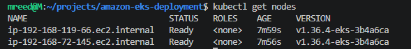
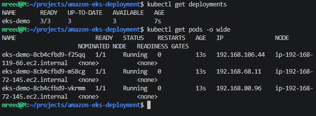
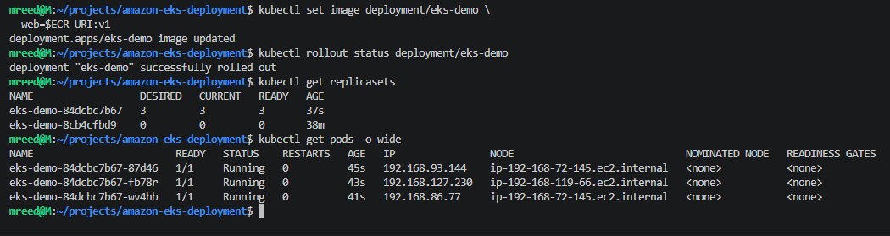
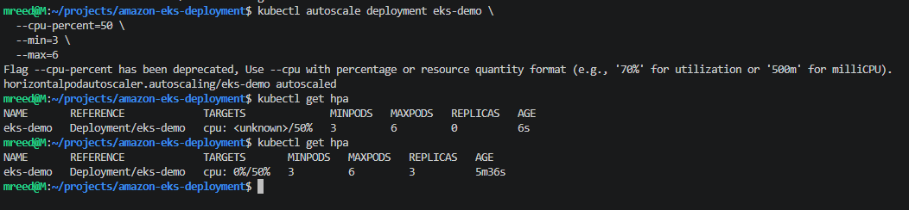
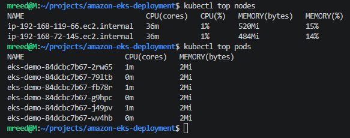
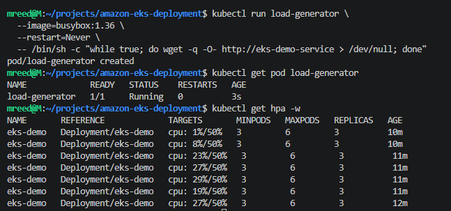
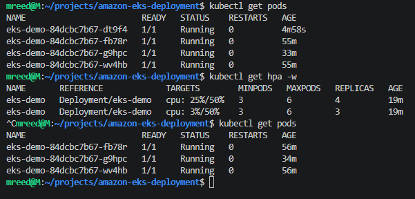
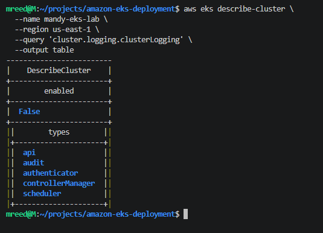
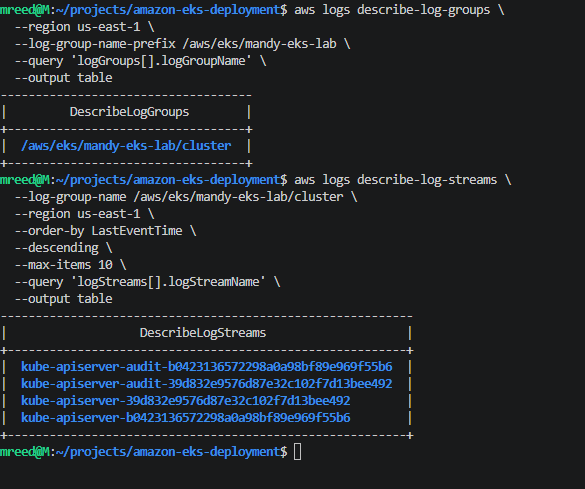
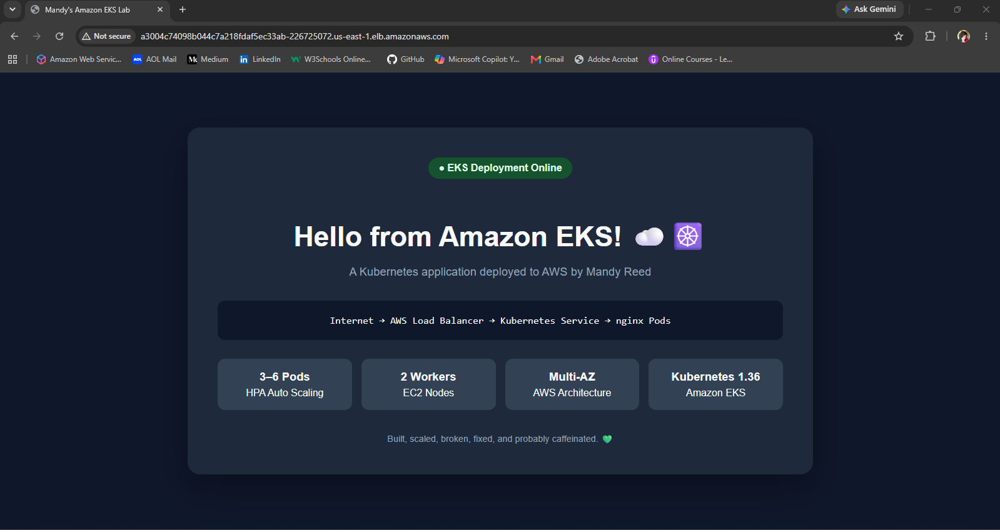

# ☸️ Amazon EKS Deployment

A hands-on Amazon EKS project focused on deploying, exposing, scaling, monitoring, updating, and troubleshooting a containerized application running on Kubernetes in AWS.

Rather than stopping after getting a workload running, I used this project to explore what happens across the full path from a local application to Docker, Amazon ECR, Kubernetes, AWS load balancing, autoscaling, and CloudWatch.

## 🏗️ Architecture

```text
Internet
   ↓
AWS Load Balancer
   ↓
Kubernetes LoadBalancer Service
   ↓
EKS Deployment
   ↓
ReplicaSet
   ↓
nginx Application Pods
   ↓
Amazon EKS Managed Worker Nodes
   ↓
Multi-AZ AWS VPC
```

Application release path:

```text
HTML/CSS
   ↓
Docker Image
   ↓
Amazon ECR
   ↓
EKS Deployment
   ↓
Rolling Update
   ↓
ReplicaSet
   ↓
Application Pods
```

## 🧰 Technologies Used

- Amazon EKS
- Amazon EC2
- Amazon ECR
- Amazon VPC
- Elastic Load Balancing
- Amazon CloudWatch
- Kubernetes
- Docker
- nginx
- eksctl
- kubectl
- AWS CLI
- Linux / WSL
- Git and GitHub

## ☁️ EKS Cluster

The EKS cluster was created with `eksctl` using a managed node group distributed across two Availability Zones.

```yaml
managedNodeGroups:
  - name: mandy-workers
    instanceType: t3.medium
    desiredCapacity: 2
    minSize: 2
    maxSize: 3
    privateNetworking: true
```

The worker nodes were placed in private networking while the EKS control plane remained accessible through the configured cluster endpoint.



## 🚀 Kubernetes Deployment

The application was deployed using a Kubernetes `Deployment` with three initial replicas.

Resource requests and limits were configured for each container:

```yaml
resources:
  requests:
    cpu: "100m"
    memory: "64Mi"
  limits:
    cpu: "250m"
    memory: "128Mi"
```

These resource requests later became important when testing Horizontal Pod Autoscaling because Kubernetes calculates CPU utilization for the HPA relative to the requested CPU.



## 🔄 Deployment, ReplicaSets, and Pods

The project demonstrated the relationship between Kubernetes objects:

```text
Deployment
    ↓
ReplicaSet
    ↓
Pods
```

Updating the Deployment created a new ReplicaSet and allowed Kubernetes to replace the previous Pods through a rolling update.



## 🌎 Exposing the Application

A Kubernetes Service of type `LoadBalancer` exposed the application externally.

```yaml
spec:
  type: LoadBalancer
```

AWS provisioned external load-balancing infrastructure, allowing the application to be reached from a browser while Kubernetes continued routing traffic to the available application Pods.

## 🐳 Custom Docker Image and Amazon ECR

The first deployment used the standard nginx image.

I then created a custom HTML/CSS application and packaged it into a Docker image:

```dockerfile
FROM nginx:1.27-alpine

COPY index.html /usr/share/nginx/html/index.html

EXPOSE 80
```

The image was versioned and pushed to a private Amazon ECR repository.

The release workflow became:

```text
Application Source
      ↓
Docker Build
      ↓
Image Tag
      ↓
Amazon ECR
      ↓
EKS Deployment
```

A second `v2` image was later built and deployed after updating the application interface.

This provided hands-on experience with a basic container release lifecycle rather than treating the container image as a static dependency.

## 🩹 Testing Kubernetes Self-Healing

To test desired-state reconciliation, I deliberately deleted one of the running application Pods.

The ReplicaSet detected that the actual state no longer matched the desired replica count and immediately created a replacement Pod.

The application remained available through the load balancer during the test.

This demonstrated one of the core Kubernetes concepts:

> Pods are disposable. The controller maintains the desired state.

## 📈 Manual Pod Scaling

The Deployment was manually scaled from three Pods to six.

```text
3 Pods
   ↓
6 Pods
```

The existing two EC2 worker nodes had enough capacity to schedule the additional Pods, so the number of worker nodes did not change.



This helped demonstrate the distinction between:

```text
Pod Scaling
     ≠
Node Scaling
```

Kubernetes can increase application replicas without adding EC2 instances when sufficient cluster capacity already exists.

## 📊 Resource Metrics

The Kubernetes Metrics Server was used to inspect real CPU and memory consumption.

```bash
kubectl top nodes
kubectl top pods
```



This provided visibility into both worker-node utilization and application-level resource consumption.

## ⚡ Horizontal Pod Autoscaling

A Horizontal Pod Autoscaler was configured with:

- Minimum replicas: 3
- Maximum replicas: 6
- CPU target: 50%

Because the application requested `100m` CPU per Pod, the HPA evaluated CPU utilization relative to that request.

Synthetic traffic was generated inside the cluster using temporary BusyBox Pods.

As CPU utilization crossed the target, the HPA automatically increased the application from three Pods to four.



After the load generators were removed and CPU utilization dropped, Kubernetes eventually returned the Deployment to its three-Pod baseline.



This demonstrated both sides of autoscaling:

```text
Traffic increases
      ↓
CPU utilization rises
      ↓
HPA adds Pods
      ↓
Traffic removed
      ↓
CPU utilization falls
      ↓
HPA returns to baseline
```

## 🖥️ Amazon CloudWatch Visibility

EKS control-plane logging was initially disabled.

API and audit logging were enabled to provide additional visibility into cluster activity.



The EKS control plane then published API server and audit log streams to Amazon CloudWatch.



This connected Kubernetes administration with AWS-native operational visibility.

## 🔁 Versioned Application Release

After the initial custom application was running successfully, I modified the HTML/CSS and created a second container version.

```text
v1
 ↓
Modify Application
 ↓
Build :v2
 ↓
Push :v2 to ECR
 ↓
Update EKS Deployment
 ↓
New ReplicaSet
 ↓
Rolling Update
 ↓
3 Pods running v2
```

The public load-balancer endpoint remained unchanged while Kubernetes replaced the application Pods behind the Service.

This demonstrated how application releases can occur independently from the external endpoint.

## 🎉 Final Application

The final application displays several characteristics of the environment directly in the interface:

- 3–6 application Pods with HPA
- 2 EC2 worker nodes
- Multi-AZ architecture
- Amazon EKS with Kubernetes 1.36



## 🧠 What I Learned

This project helped connect several concepts that can feel separate when studied individually.

### Kubernetes desired state

Deleting a Pod did not mean manually rebuilding it. The ReplicaSet recognized the missing replica and restored the desired state automatically.

### Pods and nodes scale independently

Increasing application replicas did not automatically mean increasing EC2 capacity. The scheduler placed additional Pods on the existing workers while capacity remained available.

### Resource requests matter

CPU requests were not only scheduling information. They also provided the baseline used by the HPA when calculating CPU utilization.

### Services separate applications from Pods

The external endpoint remained stable even as Pods were deleted, recreated, scaled, and replaced during rolling updates.

### Container versions support controlled releases

Using separate `v1` and `v2` image tags made it possible to release a new application version without overwriting the previous image.

### Kubernetes and AWS operate at different layers

Kubernetes managed workloads, desired state, Services, ReplicaSets, and autoscaling while AWS provided the underlying networking, compute, load balancing, image registry, and logging infrastructure.

Understanding how those layers connect was one of the most valuable parts of the project.

## 📁 Repository Structure

```text
amazon-eks-deployment/
├── app/
│   ├── Dockerfile
│   └── index.html
├── screenshots/
├── .gitignore
├── deployment.yaml
├── eks-cluster.yaml
├── service.yaml
└── README.md
```

## 🔐 Security Notes

This repository does not contain AWS credentials or account-specific ECR repository identifiers.

The Kubernetes Deployment uses:

```yaml
image: YOUR_ECR_REPOSITORY_URI:v2
```

The placeholder should be replaced with an appropriate ECR repository URI when deploying the project.

Worker nodes were configured with private networking, and AWS access was performed using IAM rather than embedding credentials into application files.

## 🧹 Cleanup

Because EKS environments can create billable AWS resources, cleanup is an important part of the project lifecycle.

Resources created for the lab were removed after validation, including the Kubernetes workload, external load-balancing resources, EKS cluster infrastructure, ECR repository, and CloudWatch logs.

## 💚 Final Takeaway

The biggest lesson from this project was that deploying an application to Kubernetes is only one piece of the story.

The more valuable learning came from following the entire path, watching how the layers interacted, deliberately changing and breaking things, and verifying how Kubernetes and AWS responded.

Built, scaled, broken, fixed, monitored, and probably caffeinated. ☁️☸️
